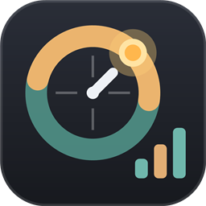

# ZoneQuanta



[中文](README.md) · **English**

**A Windows desktop world clock with a taskbar network / CPU / RAM monitor and per-app traffic statistics.** Shows local time and Los Angeles time (automatic DST), any of 36 popular cities, live upload / download speed in the taskbar, and how much traffic each application used. Lightweight WPF / .NET 8, one self-contained exe, signed auto-update.

> Keywords: world clock, time zone clock, DST, daylight saving time, Los Angeles time, desktop widget, taskbar monitor, network speed meter, upload download speed, bandwidth monitor, CPU usage, memory usage, per-app network traffic, data usage by app, Windows 10, Windows 11, WPF, .NET 8

## Features

| Feature | Details |
|---|---|
| Local + Los Angeles time | DST / standard time switches automatically using the Windows time zone database (per-year rules). Click a card to flip it: current state, next switch moment, this year's DST period (2026: Mar 8 02:00 – Nov 1 02:00), and today's sunrise / sunset / day length |
| 24-hour day ribbon | A ribbon across each card covering 0–24 h (one tick per hour, labelled 0 / 6 / 12 / 18 / 24): the daylight segment is computed per city from latitude and date (polar day / night included), the part of the day already gone is bright and the rest dimmed, a sun / moon marker sits on the current time, and sunrise / sunset times are printed on the ribbon; hover the ribbon to read any moment; cards tilt in 3D with a moving highlight; the desktop widget uses a compact layout (name + time + slim ribbon + key marks, about half the previous area) and flips on click for DST and sunrise / sunset details |
| Taskbar hover details | Rest the mouse on the taskbar monitor to see upload / download / total speed with a live chart, today's traffic, adapter and link rate, CPU usage with cores / processes / threads, memory used / available / committed, uptime and today's top apps |
| Popular countries and cities | 36 built-in cities (USA, Canada, China, Japan, Europe, Australia, ...), plus search over every system time zone. Up to 4 zones, renamable and reorderable |
| Taskbar monitor | Placed at the far left of the taskbar by default; choose "left of Start" or "left of the notification area" and fine-tune the offset. Height adapts to the taskbar with no padding. Upload speed, download speed, today’s data usage, total speed, memory % and CPU % can each be switched on or off |
| Speed units | Bytes `B` or bits `b`; unit auto (B → KB → MB → GB) or fixed K / M / G |
| Per-app traffic | Upload / download per application over: today, 24 hours, this week, this month, billing cycle, this year, all time. Sort by total / upload / download, search apps. Live speed chart and animated bars |
| Data cap | Monthly cap and reset day (1–31, clamped to the month's last day): a ring shows the share used and what is left; the Daily chart shows per-day bars with a daily-allowance line; used, daily average, daily allowance, projected cycle total, projected run-out time and days left. The daily average weights the last 14 days with a 3-day half-life so the forecast follows changes in habit. One tray alert at the chosen threshold (50–99%) and one at 100% per cycle |
| Quick panel | Like the pinned area of the Start menu: right-click a file, folder, drive or folder background in Explorer and choose "添加到快捷面板" (add to quick panel), drop files in, or use Add. System icons and names (thumbnails for images), grid or list view (the grid spreads evenly over the width, the list splits into several columns in a wide window); click to open; right-click for open, run as administrator, open with, open file location, copy path, rename, properties, remove; drag to reorder; sort by custom, name, recent, most used (7-day half-life usage score) or type; fuzzy search; path, type, size, modified time and open count can each be shown or hidden |
| Open a path | A hotkey pops up an input: type or paste a location and press Enter. Handles quoted paths, `%VARIABLES%`, `~`, `shell:` locations, URLs and names such as Desktop / Downloads / Documents; completes as you type (Tab to complete, ↑↓ to choose); Ctrl+Enter opens the containing folder, Shift+Enter adds to the quick panel; recently opened locations are listed |
| Desktop widget | Click-through, always on top, lock position, may extend past screen edges, auto-hide when a full-screen app runs; stays on screen when the desktop is shown (Win+D), everything is minimized (Win+M) or any window is minimized |
| Start with Windows | Per-user startup entry, no administrator rights needed |
| Look and feel | Four eye-friendly low-saturation themes; rolling digits, card flip, hover and page transitions (2D animation), all optional |
| Tray and hotkeys | Left-click the tray icon to show / hide the panel; right-click for the quick panel, open-a-path, the list of quick items and common switches (including the taskbar monitor); global hotkeys: panel `Ctrl + Alt + Z`, quick panel `Ctrl + Alt + Space`, open a path `Ctrl + Alt + G`, each changeable or switchable off, and a default already taken by another program is replaced by a free combination; right-click today's data to open Traffic; right-click speed / CPU / RAM to open Monitor settings |
| Auto-update | Parallel multi-mirror download, ECDSA signature + SHA-256 verification |
| Display speed | A dedicated high-resolution timer thread wakes about 12 ms before each second, so the new second is presented in the frame that contains the boundary; sampling runs on a background thread and the taskbar numbers refresh every 0.5 s by default (0.25 / 0.5 / 1 / 2 s selectable); the hover card opens in about 10 ms; the monitor follows an auto-hidden taskbar within a few milliseconds of it appearing |
| Low footprint | Redraws only what changes; sampling drops to once a second while the band is tucked away and the panel is closed; about 75 MB RAM and normally under 1% of one core when idle |

## v1.4.6

Groups, card places and the navigation order no longer "go back": tests run only on an isolated instance (`--data-dir`), the app keeps a history of versions (on start, exit, before updates and after every change) that the System page restores in one step, the quick panel has Ctrl+Z undo and Ctrl+Y redo, and fields from newer or older versions are kept. Every app on the Traffic page shows its own icon: full paths are recorded when processes start, engines without an icon of their own (xray, sing-box) show the icon of the app that ships them, and a Process / App switch merges an app's processes into one row; right-click opens the file location. Cards and switch rows on every page can be dragged: a plain drag moves the panel, a 0.3 s hold then drag rearranges and is remembered, and right-click restores the default layout. The navigation collapses to icons (‹ button or Ctrl+B, remembered), and hovering an icon shows the page's name and contents.

## v1.4.5

The quick panel no longer leaves an empty column on the right: the column count is chosen to leave the fewest empty cells. Group cards can be dragged to any cell; the others make room live with a smooth glide, and the card stays pinned there (kept across restarts); right-click to unpin one or let all flow again; dragging near the top or bottom edge scrolls. Dropping one icon on another names the new group from what the apps are for (for example "浏览器与社交通讯"), preselected so Enter accepts it; the name follows later member changes until you rename it; right-click a group, "按内容命名", to name it by content. Window size, position, maximized state and the panel page survive a restart, sign-out or update: placements are written at once, settings files reach the disk before they replace the old ones and keep a backup, and a damaged file is restored from that backup. The main panel shows the pixel size while an edge is dragged too.

## v1.4.4

Drag the navigation to move the panel, no long press needed (a click still switches pages, holding an entry still for about 0.3 s then dragging still reorders, and dragging it while maximized restores the window under the pointer); double-click the navigation's blank space to maximize or restore. On the quick panel the buttons, the empty part of the search box and the margins move the window directly; only a press on typed text still selects. Both panels remember their last size, position and maximized state across restarts and updates; the pixel size is shown in the middle while an edge is dragged; the Quick page picks where the quick panel opens (last position, screen centre, around the pointer), shows the remembered size and resets it. New `--exit` command for a clean exit.

## v1.4.2

The quick panel gains a Groups view (an icon-cell grid where each card's columns × rows size can be chosen from a picker or by dragging its corner grip, no large empty areas) with automatic and manual grouping (right-click "Move to group", drag onto a card, drag onto another icon to make a group); items that already have a group are never changed by automatic grouping. New Shortcuts page where every shortcut can be re-recorded, switched off and reset, and is remembered; the quick panel is larger, remembers its size and imports every app pinned to Start, then new pins automatically; the Traffic page lists each app with icon, description, upload, download, total and share; fixed self-update occasionally hanging.

## v1.4.1

Fixed per-app traffic counting stopping after an auto-update (the old helper died with the deleted previous executable and the new one never started).

## v1.4.0

New Quick page and quick panel: add items from Explorer's right-click menu (on Windows 11 under "Show more options", or Shift + right-click) or by dropping files; the panel shows system icons and names, opens on click and offers run as administrator, open file location, copy path, rename, properties and more on right-click, with drag-to-reorder and per-field display switches. New open-a-path hotkey with completion. The Traffic page gains a data cap: monthly cap, reset day, remaining, daily allowance, projected usage and run-out time, per-day bars and alerts; per-app traffic can be searched and sorted by upload / download. The panel no longer repeats the page name in its top-left corner, and icon buttons show their name on hover.


Panel content now fills the window at any size: themes become 2×2 tiles, Window nudges become a direction pad, and the clock preview and traffic chart grow with the height, so a maximized panel no longer shows large empty areas. The previous executable is removed right after an update instead of at the next start.

## v1.3.2

The panel caption gains a maximize / restore button next to "−" and "✕". The button, a caption double-click, dragging the caption to restore and Win+Up / Win+Down all work; "−" and "✕" still hide to the tray. A maximized panel fits the work area, so the screen edge no longer clips its content; an auto-hide taskbar can still be revealed over it; the maximized state survives hiding and reopening and show desktop.

## v1.3.1

Fixed the clock and taskbar monitor disappearing on "minimize". Showing the desktop (Win+D, Win+M, the corner button) makes Windows report the user state as "busy", exactly as it does for a full-screen app, so the program mistook it for one and hid the widget and the band. A foreground desktop, taskbar or one of our own windows is no longer treated as full screen, and a window the shell iconifies or hides is brought back at once. Measured on the real desktop: the widget and band stay visible throughout Win+D and Win+M, and nothing waits for the next second when leaving show-desktop.

## v1.3.0

This release is about display speed. The clock now comes from a dedicated high-resolution thread that wakes about 12 ms before each second and is drawn first on the UI thread, instead of queueing behind adapter sampling and taskbar relayout. Measured: the new second's text is ready about 11 ms before the flip (the previous build was 13 ms late on average), and under full CPU load the previous build stalled for up to 10 s while this one does not (the process is no longer demoted to below-normal priority and opts out of Windows 11 efficiency-mode throttling). Network / CPU / memory are sampled on a background thread and refresh every 0.5 s by default (0.25 / 1 / 2 s in the Monitor page); sampling drops to once a second while the band is tucked away and the panel is closed.

Taskbar monitor: with an auto-hidden taskbar the layout is read while it is tucked away, so the band appears within a few milliseconds of the taskbar returning (about 0.8 s the first time before). A layout change no longer hides the band and recomputes it; value changes swap text instead of re-running the font search; the hover card is mouse-event driven with its window pre-created, opening in about 10 ms. Fullscreen and "back to desktop" detection now runs the moment the foreground window changes.

Also fixed: refreshing the adapter list every 30 s produced one zero-speed second and dropped that second's traffic from the totals; when the per-app helper's scheduled task disappears the switch no longer stays on silently (it now says so and turns off); the log is rotated instead of wiped at its size limit. The tray menu gains a "Taskbar monitor" switch.


## Install

Download `ZoneQuanta.exe` (about 165 MB) from [Releases](https://github.com/Aevorine/ZoneQuanta/releases/latest) and double-click it. **The .NET runtime and every dependency are built in — nothing else to install.**

On first run you choose an install location. **Pick any folder; the app always installs into a `ZoneQuanta` folder inside it** (choose `D:\Apps` and it installs to `D:\Apps\ZoneQuanta`). A desktop shortcut and start-with-Windows are optional. The exe is not code-signed, so SmartScreen may warn about an unknown publisher: choose "Run anyway".

## Per-app traffic and administrator rights

Windows only lets administrators read per-process network events, so this feature is **optional**. Turning it on in the Traffic page triggers one system authorization and creates a scheduled task `ZoneQuantaTraffic` that runs a small helper with administrator rights (ETW `Microsoft-Windows-Kernel-Network`; it records only process names and byte counts, never content). Turning the switch off deletes the task. Without it you still get total traffic and live speed.

With a local proxy or TUN adapter, traffic is attributed to the proxy process.

## Usage

- Left-click the tray icon to open / close the panel; the taskbar entry disappears when it is closed. Right-click for switches, the quick panel, open-a-path and the quick item list
- Ten pages: Console, Display, Time zones, Monitor, Traffic, Quick, Shortcuts, Window, System, Update. Drag anywhere on the navigation (entries, blank space, version label) to move the panel, a click still switches pages; hold an entry still for about 0.3 s, then drag it to reorder (right-click the navigation to restore the default order); double-click the blank space to maximize or restore, and drag it while maximized to restore under the pointer. On the quick panel the margins, top-bar gaps, buttons and the empty part of the search box move the window directly (typed text: a drag selects, a 0.3 s hold then drag moves). Both panels reopen at their last size, position and maximized state (mapped proportionally and kept fully visible on another monitor or resolution); the Quick page sets where the quick panel opens and resets its size. Hover a group card and drag its corner grip to resize it by whole cells. Every shortcut can be changed, switched off or reset on the Shortcuts page and is remembered in settings.json; apps pinned to Start are imported into the quick panel automatically and shown in groups (automatic grouping only fills items that have no group yet; manual placement always wins)
- Navigation: the ‹ button at the bottom or `Ctrl + B` collapses it to icons and back, remembered; hover an icon for the page name and contents
- Page content: press a card, switch row or blank space and move to drag the panel; hold still about 0.3 s, then drag to lift the card or row and drop it elsewhere (kept across restarts and updates); right-click blank space for 恢复默认布局 (default layout)
- Traffic page: 进程 / 应用 shows one row per process or merges an app's processes; hover for paths and member totals; right-click to open the file location, copy the path or show properties
- History: settings and the quick panel are saved on start, exit, before updates and restores, and after each change (identical content skipped; newest 60 plus one a day for 30 days); System → 历史版本 shows time, reason and changes, ↺ then 确认恢复 goes back (the current state is saved first and the app restarts); + saves one now, the folder button opens the history folder
- Undo / redo on the quick panel: `Ctrl + Z` / `Ctrl + Y` (or `Ctrl + Shift + Z`), 50 steps
- Settings, logs and statistics live in `%APPDATA%\ZoneQuanta` (quick items in `quick.json`, history in `history\`)

| Hotkey | Action |
|---|---|
| `Ctrl + Alt + Z` | Show / hide the panel |
| `Ctrl + Alt + Space` | Show / hide the quick panel |
| `Ctrl + Alt + G` | Open-a-path input |
| In the quick panel: `Enter` / `Ctrl + Enter` / `F2` / `Del` / `Ctrl + C` | Open / open location / rename / remove / copy path |
| In the path input: `Tab` / `↑↓` / `Enter` / `Ctrl + Enter` / `Shift + Enter` / `Esc` | Complete / choose / open / open location / add to quick panel / clear or close |

Command line (usable from scripts and Claude Code; a second launch hands the command to the running instance and exits):

| Command | Action |
|---|---|
| `ZoneQuanta.exe --quick-add <path> [<path> …]` | Add files / folders to the quick panel (relative paths use the current directory) |
| `ZoneQuanta.exe --quick` | Show the quick panel |
| `ZoneQuanta.exe --path-bar` | Show the open-a-path input |
| `ZoneQuanta.exe --open <path or URL>` | Open a location with the same rules as the input |
| `ZoneQuanta.exe --panel [page]` | Open the panel, optionally on a page, e.g. `--panel 流量` |
| `ZoneQuanta.exe --exit` | Exit the running instance cleanly (settings and window positions are saved first) |
| `ZoneQuanta.exe --data-dir <dir> [command]` | Run a separate instance on an isolated data folder (for tests and demos: no hotkeys, Explorer verb, traffic helper or updates, real data untouched); or set `ZONEQUANTA_DATA` |

`%APPDATA%\ZoneQuanta\app.log` has millisecond timestamps and records quick-panel adds, opens, removes, moves, grouping, renames and undo, the settings each save touched, history snapshots and restores, navigation collapse, icon-resolution timings, hotkey conflicts and fallbacks, data-cap alerts and Explorer menu registration.

## Architecture

```
src/ZoneQuanta
├── Core        pure logic, no UI dependency
│   ├── Settings   settings model and persistence
│   ├── Time       time zones, DST, sunrise / sunset (astronomical), city catalog, high-resolution pre-boundary ticker
│   ├── Monitor    background sampler (network / CPU / memory), unit conversion, traffic store
│   ├── Traffic    elevated statistics helper (ETW) and scheduled-task launcher
│   └── Update     manifest verification, parallel download, update coordinator
├── Platform    Win32 wrappers: window styles, full-screen detection, foreground watcher, taskbar tracking and layout, hotkey, autostart
├── Shell       tray icon
├── UI          Theme, Controls, Widget, Band (taskbar monitor), Setup (installer), Panel
└── AppController  composition root
```

## Build

Requires the .NET 8 SDK: `dotnet build src/ZoneQuanta -c Release`. The release flow is `scripts/release.ps1` (build, sign, create the Release, keep only the latest two). The signing key is not in this repository.

## License

MIT
